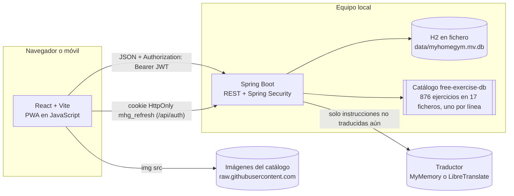

# Arquitectura de MyHomeGym

Documento de diseño del sistema: qué hace, cómo se reparte el trabajo entre frontend y backend, por qué se tomó cada decisión y qué conviene revisar cuando el proyecto crezca.

## 1. Requisitos

### Funcionales

- Registrar entrenamientos de fuerza (guiados por rutina o libres), series, RPE y récords personales.
- Gestionar rutinas, carpetas, plantillas y ejercicios propios.
- Consultar un catálogo de ejercicios en español con imágenes e instrucciones.
- Ver progreso: volumen, 1RM estimado, medidas corporales y mapa muscular.
- Cuentas de usuario con JWT; cada usuario solo ve sus datos.
- Exportar e importar una copia completa de los datos.

Detalle y criterios de aceptación en [REQUISITOS_FUNCIONALES_Y_ACEPTACION.md](./REQUISITOS_FUNCIONALES_Y_ACEPTACION.md).

### No funcionales

| Atributo | Objetivo |
| --- | --- |
| Despliegue | Todo en local: un único proceso Java y un fichero de base de datos. Sin servicios en la nube. |
| Escala | Un hogar o un grupo pequeño: decenas de usuarios, miles de series por usuario. |
| Privacidad | Los datos no salen del equipo. Solo salen las peticiones de imágenes del catálogo y de traducción de instrucciones. |
| Seguridad | Contraseñas con BCrypt, JWT de acceso corto, token de refresco rotatorio en cookie HttpOnly, aislamiento por usuario comprobado con tests. |
| Mantenibilidad | Proyecto abierto a pull requests: CI que compila y prueba ambos lados, sin secretos. |

### Restricciones

- Stack elegido: React + Vite + JavaScript en el frontend, Spring Boot + JWT en el backend.
- Un solo mantenedor que revisa contribuciones externas.

## 2. Vista general

En producción local el backend sirve también el frontend compilado (`npm run build:backend` lo copia a `backend/src/main/resources/static`), así que todo vive en `http://localhost:8080` con un único origen. En desarrollo, Vite corre en `:5173` y su proxy reenvía `/api` al backend.

## 3. Backend

### Paquetes

| Paquete | Responsabilidad |
| --- | --- |
| `config` | Seguridad (cadena de filtros, CORS), claves JWT, propiedades `app.*`, reenvío de rutas de la SPA. |
| `auth` | Registro, login, refresco y cierre de sesión; cuentas y tokens de refresco; límite de intentos fallidos. |
| `common` | `OwnedEntity` y `OwnedCrudController`: el CRUD genérico por usuario que reutilizan todos los recursos. `ApiException` y `ApiExceptionHandler`: errores con código estable. |
| `domain` | Entidades del dominio y sus controladores (perfil, rutinas, entrenamientos, series, medidas, récords...). |
| `catalog` | Carga del catálogo y adaptación al modelo de la app, en el idioma pedido. |
| `translation` | Traducción automática con proveedores intercambiables y caché en base de datos. `SpanishRegister` pasa a "tú" las traducciones al español. |
| `backup` | Exportar, fusionar, sustituir y borrar todos los datos de un usuario. |

### API REST

Todas las rutas cuelgan de `/api`. Salvo las marcadas como públicas, requieren `Authorization: Bearer <JWT>`.

| Método y ruta | Uso |
| --- | --- |
| `POST /auth/register`, `POST /auth/login` | Públicas. Devuelven `{accessToken, expiresIn, user}` y ponen la cookie de refresco. |
| `POST /auth/refresh`, `POST /auth/logout` | Públicas, usan la cookie. Refresco con rotación. |
| `GET /auth/me` | Usuario actual. |
| `GET /catalog/exercises?lang=es` | Pública. Catálogo completo sin instrucciones. |
| `GET /catalog/exercises/{id}?lang=es` | Pública. Ficha con pasos traducidos. |
| `GET/PUT/PATCH/DELETE /{recurso}/{id}`, `GET /{recurso}`, `POST /{recurso}/bulk`, `DELETE /{recurso}` | CRUD por usuario para `profiles`, `custom-exercises`, `routines`, `routine-folders`, `routine-exercises`, `trainings`, `performed-sets`, `body-measurements`, `personal-records`, `exercise-notes`. |
| `POST /trainings/complete` | Entrenamiento y sus series en una transacción. |
| `POST /trainings/{id}/correction` | Corrige una sesión pasada: kilos y repeticiones de sus series, su volumen y los récords afectados (`{remove, add}`, calculados en el cliente), en una transacción. |
| `POST /routine-exercises/reorder` | Reordenación atómica. |
| `GET/PUT /settings/notifications` | Ajustes de avisos. |
| `GET /data/export` | Copia completa de los datos del usuario. |
| `POST /data/merge` | Añade lo que falta de una copia sin borrar nada, en una transacción. Devuelve `{imported, skipped}`. Es lo que usa la app al restaurar. |
| `POST /data/import` | Sustituye todos los datos por los de la copia. |
| `DELETE /data` | Borra todos los datos del usuario (no la cuenta). |
| `DELETE /routine-folders/{id}` | Además de borrar la carpeta, deja sus rutinas sin carpeta. |
| `DELETE /custom-exercises/{id}` | Además de borrar el ejercicio, lo quita de las rutinas y borra su nota. |
| `GET /health` | Pública. Comprobación de vida. |

Los errores siempre tienen la forma `{"error": "texto en español", "code": "CODIGO"}`. El código es estable (`USERNAME_TAKEN`, `BAD_CREDENTIALS`, `TOO_MANY_ATTEMPTS`, `SESSION_EXPIRED`, `VALIDATION`, `BAD_JSON`, `NOT_FOUND`, `DUPLICATE_ID`): el cliente lo traduce al idioma del usuario (`src/lib/errorMessages.js`) y nunca muestra el texto del servidor.

En un `PATCH`, un campo con `null` vacía ese campo; un campo ausente no se toca. Todo lo que se guarda se valida, también al restaurar una copia.

### Modelo de datos

- Los ids de dominio son UUID generados en el cliente. Así la interfaz puede crear registros (por ejemplo, las series de un entrenamiento) sin esperar al servidor, y la importación de copias conserva las relaciones.
- Cada entidad de dominio lleva `ownerId`, que nunca viaja en JSON (`@JsonIgnore`) y que fija siempre el servidor a partir del `sub` del JWT.
- Las fechas se guardan como texto ISO 8601, el mismo formato que usa el frontend para ordenar y filtrar.
- El esquema lo mantiene Hibernate (`ddl-auto: update`). Ver el punto 6.

### Autenticación

1. `login` comprueba la contraseña con BCrypt (coste 12). Si el usuario no existe, compara igualmente contra un hash ficticio para que el tiempo de respuesta no revele qué usuarios existen.
2. Emite un JWT HS256 de 15 minutos con `sub = id de usuario`.
3. Emite un token de refresco aleatorio de 256 bits, guarda solo su SHA-256 y lo envía en la cookie `mhg_refresh` (`HttpOnly`, `SameSite=Strict`, `Path=/api/auth`).
4. El cliente guarda el JWT solo en memoria. Ante un 401 llama a `/auth/refresh`, que revoca el token usado y emite otro. Si llega un token ya revocado se revocan todas las sesiones del usuario (detección de reutilización).
5. Tras 5 fallos seguidos, el usuario queda bloqueado 15 minutos.

La clave HMAC se genera la primera vez en `data/jwt-secret.key` con permisos `600`, o se toma de `MYHOMEGYM_JWT_SECRET`.

### Catálogo y traducción

| Dato | Cómo se traduce | Por qué |
| --- | --- | --- |
| Nombres (876) | A mano, campo `nameEs` en `catalog/exercises/<músculo>.json` | Son lo que más se lee; la traducción automática de nombres cortos es la que peor sale. |
| Músculos, material, nivel, categoría | Vocabulario fijo en `CatalogVocabulary` | Conjunto cerrado; filtros y estadísticas necesitan valores estables. |
| Descripción | Se genera a partir de los datos estructurados | No inventa nada que no esté en la fuente. |
| Instrucciones | Traducción automática bajo demanda, en caché | Son 575.000 caracteres: traducirlas a mano no es viable y se leen bastante menos. |

Si el traductor falla, se devuelve el original y no se guarda nada, de modo que se reintenta en la siguiente visita. La ficha avisa al usuario en ambos casos.

## 4. Frontend

- React 19 + Vite 7 + JavaScript, Tailwind, Zustand, i18next, Recharts, PWA. Tipografías empaquetadas con Fontsource: la app no carga nada de terceros salvo las fotos del catálogo.
- `src/lib/api.js`: cliente HTTP. JWT en memoria, refresco automático, caché de lecturas que se invalida con cada escritura y aviso de "datos cambiados".
- `src/lib/db.js`: fachada de datos sobre la API. Es el único punto que habría que sustituir para guardar los datos en el móvil (ver [ANDROID.md](ANDROID.md)). En un cambio parcial, convierte los campos sin valor en `null` para que el servidor los vacíe.
- `src/lib/liveQuery.js`: consulta reactiva. Vuelve a consultar al montar, al cambiar dependencias y tras cualquier escritura.
- `src/utils/` y `src/lib/prs.js`: las reglas de negocio como funciones puras, sin React, con sus tests: volumen y 1RM (`calculations`), doble progresión y series (`workoutRules`), reloj del entreno (`workoutClock`), rachas y aviso de racha (`streaks`), mapa muscular (`muscleMap`), discos (`plateCalculator`) y récords (`prs`).
- `src/lib/backup/`: copia JSON, CSV y PDF, cada formato en su fichero.
- `src/components/ui/ErrorToast.jsx`: aviso general cuando una escritura falla y la pantalla no lo gestiona.
- Capas: pantallas → hooks → repositorios → `db.js` → `api.js`. La UI no llama a `fetch` directamente.

### Sistema visual

"Suelo de caucho y discos de colores": fondo casi negro con un toque morado, texto color tiza, violeta (`gym-accent`, #9284FA) como único color de acción y el código de colores de los discos (rojo 25, azul 20, amarillo 15, verde 10) reservado para datos. Los errores y las acciones de borrar usan `gym-danger`. Tipografías: Big Shoulders Display para títulos y cifras, Barlow para el texto. El único elemento decorativo es la barra cargada, que siempre representa un dato real (tu mejor serie de la última sesión). Los tokens están en `frontend/tailwind.config.js`; el color de acción y los fondos salen de variables CSS en `frontend/src/styles/theme.css`, así que cambiar de paleta es cambiar ese bloque.

## 5. Decisiones y compromisos

| Decisión | A favor | En contra |
| --- | --- | --- |
| H2 en fichero en vez de PostgreSQL | Cero instalación, un solo proceso, copia de seguridad = copiar un fichero | No pensado para muchos usuarios concurrentes; migrar más adelante requiere un cambio de URL y de dialecto |
| CRUD genérico por usuario | Una sola implementación auditada de la regla de propiedad; añadir un recurso son 10 líneas | Endpoints menos expresivos; la lógica especial va en métodos propios (`complete`, `reorder`) |
| Récords recalculados en el cliente al corregir una sesión | Una sola implementación de las reglas de récords (`prs.js`); el servidor solo aplica el cambio en una transacción | El cliente descarga entrenos, series y récords para recalcular; con muchos años de datos convendrá hacerlo en el servidor |
| Ids generados en el cliente | Creación sin esperar al servidor; importación sencilla | Hay que comprobar que un id no pertenezca a otro usuario (hecho en `OwnedCrudController`) |
| Filtrado en el cliente (`getTrainingsSince`, etc.) | Mantiene la interfaz antigua sin reescribir pantallas | Se descargan listas completas; con años de datos convendrá filtrar en el servidor |
| Catálogo dentro del backend | Funciona sin API externa; ids estables; ningún emparejamiento por nombre | Actualizar el catálogo exige una nueva versión |
| MyMemory como traductor por defecto | Gratis y sin clave | Cuota diaria limitada y calidad irregular (mezcla tú y usted, que `SpanishRegister` corrige en los casos frecuentes); se puede cambiar por LibreTranslate local |
| Solo modo oscuro | Una única paleta cuidada y coherente | Quien prefiera el modo claro no lo tiene por ahora |

### Integración continua y versiones

- `.github/workflows/ci.yml` pasa en cada push y pull request las mismas comprobaciones que exige [AGENTS.md](../AGENTS.md).
- `.github/workflows/release.yml` se lanza al subir una etiqueta `v*`: comprueba que coincide con la versión de `package.json` y `pom.xml`, repite las comprobaciones, construye el `.jar` con la interfaz dentro y publica la release (como *pre-release* si la versión lleva guion, por ejemplo `1.0.0-beta.1`). El procedimiento está en [RELEASE.md](RELEASE.md).

## 6. Qué revisar cuando crezca

1. **Migraciones de esquema**: sustituir `ddl-auto: update` por Flyway en cuanto haya usuarios con datos reales que no se puedan perder.
2. **Consultas en el servidor**: añadir filtros por fecha y ejercicio a la API y dejar de descargar listas completas.
3. **Móvil**: empaquetar el frontend con Capacitor. El backend debe estar accesible en la red local (o en un servidor propio) y con HTTPS, activando `app.cookies.secure=true`.
4. **Traducciones revisadas**: permitir que la comunidad corrija instrucciones mediante un fichero `instructions.es.json` que tenga prioridad sobre la traducción automática.
5. **Observabilidad**: Spring Boot Actuator y registros estructurados si se despliega fuera de un único equipo.
6. **Límite de intentos persistente**: hoy vive en memoria y se reinicia con el proceso.
