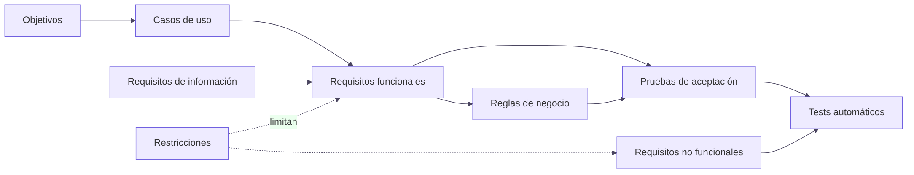
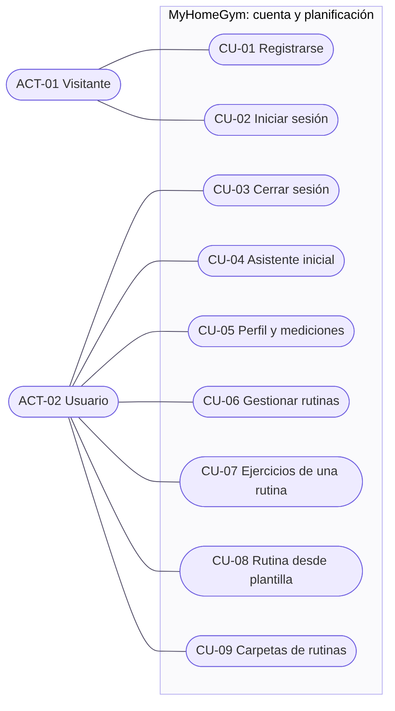
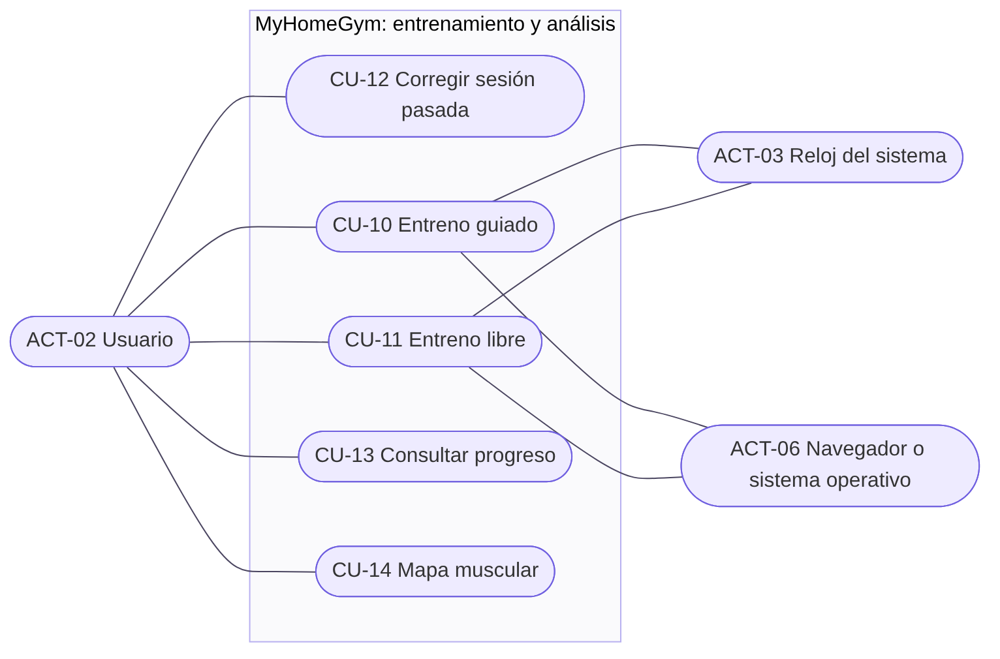
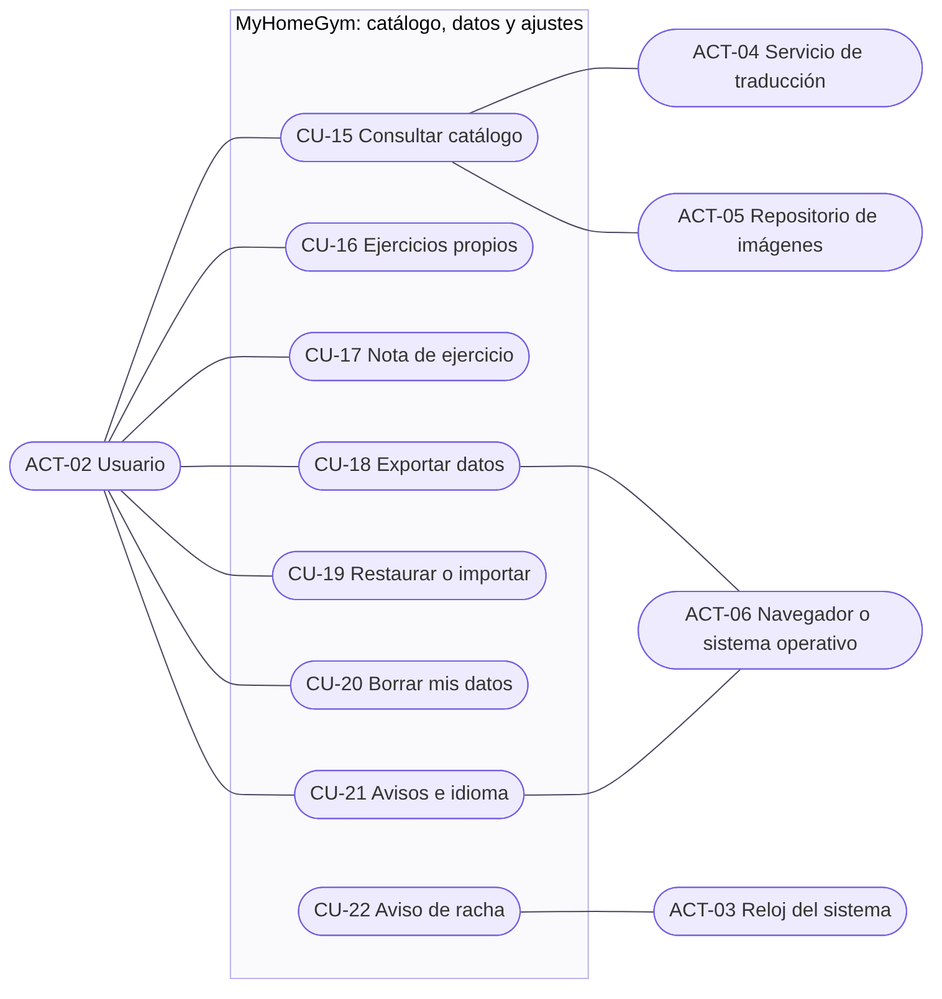
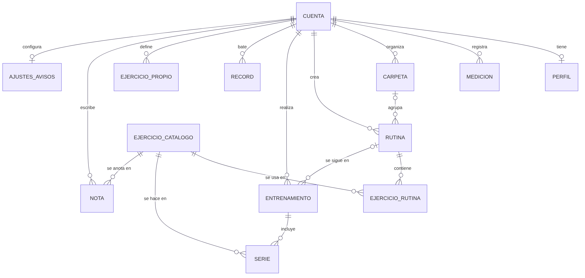
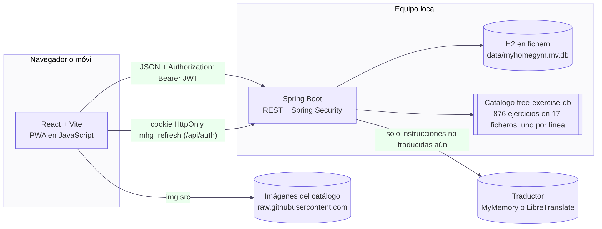

# Diagramas

Todos los diagramas de la documentación en imagen, para verlos sin un visor de Mermaid o imprimirlos. La fuente de cada uno es el bloque `mermaid` del documento indicado: si cambias el diagrama allí, regenera las imágenes (`mmdc`, Mermaid CLI) para que no se desfasen.

| Diagrama | Documento de origen |
| --- | --- |
| [Relación entre los elementos de la ERS](#relación-entre-los-elementos-de-la-ers) | [Índice de la ERS](REQUISITOS_FUNCIONALES_Y_ACEPTACION.md) |
| [Casos de uso: cuenta y planificación](#casos-de-uso-cuenta-y-planificación) | [ERS 8.2.1](requisitos/08-actores-y-casos-de-uso.md) |
| [Casos de uso: entrenamiento y análisis](#casos-de-uso-entrenamiento-y-análisis) | [ERS 8.2.2](requisitos/08-actores-y-casos-de-uso.md) |
| [Casos de uso: catálogo, datos y ajustes](#casos-de-uso-catálogo-datos-y-ajustes) | [ERS 8.2.3](requisitos/08-actores-y-casos-de-uso.md) |
| [Modelo de datos (entidad-relación)](#modelo-de-datos-entidad-relación) | [ERS 10](requisitos/10-requisitos-de-informacion.md) |
| [Vista general de la arquitectura](#vista-general-de-la-arquitectura) | [Arquitectura, sección 2](ARCHITECTURE.md) |

## Relación entre los elementos de la ERS

Origen: [Índice de la ERS](REQUISITOS_FUNCIONALES_Y_ACEPTACION.md).

## Casos de uso: cuenta y planificación

Origen: [ERS 8.2.1](requisitos/08-actores-y-casos-de-uso.md).

## Casos de uso: entrenamiento y análisis

Origen: [ERS 8.2.2](requisitos/08-actores-y-casos-de-uso.md).

## Casos de uso: catálogo, datos y ajustes

Origen: [ERS 8.2.3](requisitos/08-actores-y-casos-de-uso.md).

## Modelo de datos (entidad-relación)

Origen: [ERS 10](requisitos/10-requisitos-de-informacion.md).

## Vista general de la arquitectura

Origen: [Arquitectura, sección 2](ARCHITECTURE.md).

