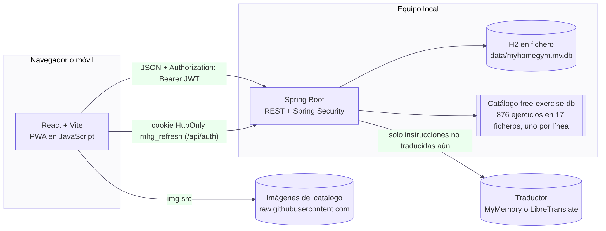

# MyHomeGym architecture

**English** · [Español](../es/ARCHITECTURE.md)

System design document: what it does, how the work is split between frontend and backend, why each decision was made and what to revisit as the project grows.

## 1. Requirements

### Functional

- Log strength workouts (guided by a routine or free), sets, RPE and personal records.
- Manage routines, folders, templates and your own exercises.
- Browse an exercise catalog in Spanish and English with images and instructions.
- See progress: volume, estimated 1RM, body measurements and muscle map.
- User accounts with JWT; each user only sees their own data.
- Export and import a full copy of the data.

Details and acceptance criteria are in the requirements specification (in Spanish): [REQUISITOS_FUNCIONALES_Y_ACEPTACION.md](../es/REQUISITOS_FUNCIONALES_Y_ACEPTACION.md).

### Non-functional

| Attribute | Goal |
| --- | --- |
| Deployment | Everything local: a single Java process and a database file. No cloud services. |
| Scale | A household or a small group: tens of users, thousands of sets per user. |
| Privacy | Data never leaves the machine. Only catalog image requests and instruction translation requests go out. |
| Security | BCrypt passwords, short-lived access JWT, rotating refresh token in an HttpOnly cookie, per-user isolation checked by tests. |
| Maintainability | Open to pull requests: CI that builds and tests both sides, no secrets. |

### Constraints

- Chosen stack: React + Vite + JavaScript in the frontend, Spring Boot + JWT in the backend.
- A single maintainer who reviews external contributions.

## 2. Overview

The diagram (in Spanish) is in [DIAGRAMAS.md](../es/DIAGRAMAS.md#vista-general-de-la-arquitectura):

The browser (or phone) runs the React PWA, which talks to the Spring Boot API with JSON and an `Authorization: Bearer` JWT, plus the HttpOnly `mhg_refresh` cookie on `/api/auth`. The API stores data in an H2 file database (`data/myhomegym.mv.db`) and reads the free-exercise-db catalog (876 exercises in 17 files, one per line) bundled in the backend. Only two things go outside: the API asks the translator (MyMemory or LibreTranslate) for instructions not yet translated, and the browser loads catalog images from `raw.githubusercontent.com`.

In local production the backend also serves the built frontend (`npm run build:backend` copies it to `backend/src/main/resources/static`), so everything lives at `http://localhost:8080` on a single origin. In development, Vite runs on `:5173` and its proxy forwards `/api` to the backend.

## 3. Backend

Many identifiers in the code are in Spanish, for example the `Training` entity with its `fecha`, `rutinaId` and `volumenTotal` fields.

### Packages

| Package | Responsibility |
| --- | --- |
| `config` | Security (filter chain, CORS), JWT keys, `app.*` properties, forwarding of SPA routes. |
| `auth` | Sign-up, sign-in, refresh and sign-out; accounts and refresh tokens; failed-attempt limit. |
| `common` | `OwnedEntity` and `OwnedCrudController`: the generic per-user CRUD reused by every resource. `ApiException` and `ApiExceptionHandler`: errors with a stable code. |
| `domain` | Domain entities and their controllers (profile, routines, workouts, sets, measurements, records...). |
| `catalog` | Loads the catalog and adapts it to the app's model, in the requested language. |
| `translation` | Machine translation with swappable providers and a database cache. `SpanishRegister` makes Spanish translations address the user as "tú". |
| `backup` | Export, merge, replace and delete all of a user's data. |

### REST API

Every route hangs from `/api`. Unless marked public, they require `Authorization: Bearer <JWT>`.

| Method and route | Use |
| --- | --- |
| `POST /auth/register`, `POST /auth/login` | Public. Return `{accessToken, expiresIn, user}` and set the refresh cookie. |
| `POST /auth/refresh`, `POST /auth/logout` | Public, use the cookie. Refresh with rotation. |
| `GET /auth/me` | Current user. |
| `GET /catalog/exercises?lang=es` | Public. Full catalog without instructions. |
| `GET /catalog/exercises/{id}?lang=es` | Public. Exercise detail with translated steps. |
| `GET/PUT/PATCH/DELETE /{resource}/{id}`, `GET /{resource}`, `POST /{resource}/bulk`, `DELETE /{resource}` | Per-user CRUD for `profiles`, `custom-exercises`, `routines`, `routine-folders`, `routine-exercises`, `trainings`, `performed-sets`, `body-measurements`, `personal-records`, `exercise-notes`. |
| `POST /trainings/complete` | A workout and its sets in one transaction. |
| `POST /trainings/{id}/correction` | Corrects a past session: weight and reps of its sets, its volume and the affected records (`{remove, add}`, computed by the client), in one transaction. |
| `POST /routine-exercises/reorder` | Atomic reordering. |
| `GET/PUT /settings/notifications` | Reminder settings. |
| `GET /data/export` | Full copy of the user's data. |
| `POST /data/merge` | Adds what's missing from a backup without deleting anything, in one transaction. Returns `{imported, skipped}`. It's what the app uses to restore. |
| `POST /data/import` | Replaces all data with the backup's. |
| `DELETE /data` | Deletes all of the user's data (not the account). |
| `DELETE /routine-folders/{id}` | Besides deleting the folder, leaves its routines without a folder. |
| `DELETE /custom-exercises/{id}` | Besides deleting the exercise, removes it from routines and deletes its note. |
| `GET /health` | Public. Health check. |

Errors always look like `{"error": "text in Spanish", "code": "CODE"}`. The code is stable (`USERNAME_TAKEN`, `BAD_CREDENTIALS`, `TOO_MANY_ATTEMPTS`, `SESSION_EXPIRED`, `VALIDATION`, `BAD_JSON`, `NOT_FOUND`, `DUPLICATE_ID`): the client translates it into the user's language (`src/lib/errorMessages.js`) and never shows the server's text.

In a `PATCH`, a field set to `null` clears that field; a missing field is left as it is. Everything that is saved is validated, including when restoring a backup.

### Data model

- Domain ids are UUIDs generated by the client. That way the interface can create records (for example, a workout's sets) without waiting for the server, and imported backups keep their relationships.
- Every domain entity has an `ownerId`, which never travels in JSON (`@JsonIgnore`) and is always set by the server from the JWT's `sub`.
- Dates are stored as ISO 8601 text, the same format the frontend uses to sort and filter.
- The schema is maintained by Hibernate (`ddl-auto: update`). See section 6.

The entity-relationship diagram (in Spanish) is in [DIAGRAMAS.md](../es/DIAGRAMAS.md#modelo-de-datos-entidad-relación).

### Authentication

1. `login` checks the password with BCrypt (cost 12). If the user doesn't exist, it still compares against a dummy hash so the response time doesn't reveal which users exist.
2. It issues a 15-minute HS256 JWT with `sub = user id`.
3. It issues a random 256-bit refresh token, stores only its SHA-256 and sends it in the `mhg_refresh` cookie (`HttpOnly`, `SameSite=Strict`, `Path=/api/auth`).
4. The client keeps the JWT only in memory. On a 401 it calls `/auth/refresh`, which revokes the used token and issues another. If an already revoked token arrives, all of the user's sessions are revoked (reuse detection).
5. After 5 failures in a row, the user is locked for 15 minutes.

The HMAC key is generated the first time in `data/jwt-secret.key` with `600` permissions, or taken from `MYHOMEGYM_JWT_SECRET`.

### Catalog and translation

| Data | How it's translated | Why |
| --- | --- | --- |
| Names (876) | By hand, `nameEs` field in `catalog/exercises/<muscle>.json` | They're what gets read most; machine translation of short names is the worst. |
| Muscles, equipment, level, category | Fixed vocabulary in `CatalogVocabulary` | A closed set; filters and statistics need stable values. |
| Description | Generated from the structured data | It doesn't invent anything that isn't in the source. |
| Instructions | On-demand machine translation, cached | 575,000 characters: translating them by hand isn't viable, and they're read much less. |

If the translator fails, the original is returned and nothing is stored, so it's retried on the next visit. The exercise page tells the user in both cases. In English, instructions are shown as they are.

## 4. Frontend

- React 19 + Vite 7 + JavaScript, Tailwind, Zustand, i18next, Recharts, PWA. Fonts bundled with Fontsource: the app loads nothing from third parties except the catalog photos.
- `src/lib/api.js`: HTTP client. JWT in memory, automatic refresh, a read cache invalidated on every write, and a "data changed" signal.
- `src/lib/db.js`: data facade over the API. It's the only piece to replace to store the data on the phone (see the Android plan, in Spanish: [ANDROID.md](../es/ANDROID.md)). In a partial update, it turns empty fields into `null` so the server clears them.
- `src/lib/liveQuery.js`: reactive query. Re-queries on mount, when dependencies change and after any write.
- `src/utils/` and `src/lib/prs.js`: the business rules as pure functions, without React, with their tests: volume and 1RM (`calculations`), double progression and sets (`workoutRules`), workout clock (`workoutClock`), streaks and streak reminder (`streaks`), muscle map (`muscleMap`), plates (`plateCalculator`) and records (`prs`).
- `src/lib/backup/`: JSON backup, CSV and PDF, each format in its own file.
- `src/components/ui/ErrorToast.jsx`: general notice when a write fails and the screen doesn't handle it.
- Layers: screens → hooks → repositories → `db.js` → `api.js`. The UI never calls `fetch` directly.

### Visual system

"Rubber floor and colored plates": an almost black background with a hint of purple, chalk-colored text, violet (`gym-accent`, #9284FA) as the only action color, and the plate color code (red 25, blue 20, yellow 15, green 10) reserved for data. Errors and delete actions use `gym-danger`. Fonts: Big Shoulders Display for headings and figures, Barlow for text. The only decorative element is the loaded barbell, which always shows real data (your best set from the last session). The tokens are in `frontend/tailwind.config.js`; the action color and backgrounds come from CSS variables in `frontend/src/styles/theme.css`, so changing the palette means changing that block.

## 5. Decisions and trade-offs

| Decision | For | Against |
| --- | --- | --- |
| File-based H2 instead of PostgreSQL | Zero install, a single process, backup = copying a file | Not meant for many concurrent users; migrating later needs a URL and dialect change |
| Generic per-user CRUD | A single audited implementation of the ownership rule; adding a resource takes 10 lines | Less expressive endpoints; special logic goes in its own methods (`complete`, `reorder`) |
| Records recalculated in the client when correcting a session | A single implementation of the record rules (`prs.js`); the server only applies the change in a transaction | The client downloads workouts, sets and records to recalculate; with years of data it should move to the server |
| Ids generated by the client | Creation without waiting for the server; simple imports | You have to check that an id doesn't belong to another user (done in `OwnedCrudController`) |
| Filtering in the client (`getTrainingsSince`, etc.) | Keeps the old interface without rewriting screens | Full lists are downloaded; with years of data, filtering should move to the server |
| Catalog inside the backend | Works without an external API; stable ids; no matching by name | Updating the catalog requires a new version |
| MyMemory as the default translator | Free and keyless | Limited daily quota and uneven quality (mixes "tú" and "usted", which `SpanishRegister` fixes in common cases); can be swapped for a local LibreTranslate |
| Dark mode only | A single, consistent palette | People who prefer light mode don't have it yet |

### Continuous integration and releases

- `.github/workflows/ci.yml` runs, on every push and pull request, the same checks required by [AGENTS.md](../../AGENTS.md).
- `.github/workflows/release.yml` runs when a `v*` tag is pushed: it checks that it matches the version in `package.json` and `pom.xml`, repeats the checks, builds the `.jar` with the interface inside and publishes the release (as a *pre-release* if the version has a hyphen, for example `1.0.0-beta.1`). The release notes live in `docs/release-notes/`. The maintainer procedure (in Spanish) is in [RELEASE.md](../es/RELEASE.md).

## 6. What to revisit as it grows

1. **Schema migrations**: replace `ddl-auto: update` with Flyway as soon as there are users with real data that can't be lost.
2. **Server-side queries**: add date and exercise filters to the API and stop downloading full lists.
3. **Mobile**: package the frontend with Capacitor. The backend must be reachable on the local network (or on your own server) over HTTPS, with `app.cookies.secure=true`.
4. **Reviewed translations**: let the community fix instructions with an `instructions.es.json` file that takes priority over machine translation.
5. **Observability**: Spring Boot Actuator and structured logs if it's deployed beyond a single machine.
6. **Persistent attempt limit**: it lives in memory today and resets with the process.
