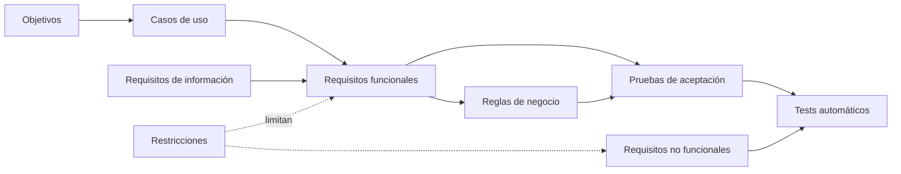

# MyHomeGym: Especificación de Requisitos Software (ERS)

| | |
| --- | --- |
| **Versión** | 2.3 |
| **Fecha** | 17 de noviembre de 2026 |
| **Autor** | Antonio M. Bernaza Holgado |
| **Estado** | Aprobada para la versión 1.0.0-beta.1. Incluye la evolución prevista a Android (propuesta). |
| **Métodos** | ISO/IEC/IEEE 29148, plantillas de Durán y Bernárdez (Universidad de Sevilla), ISO/IEC 25010, criterios de ajuste de Volere |

Qué debe hacer MyHomeGym, con qué reglas y con qué calidad, y cómo se comprueba cada cosa. Para una explicación en prosa de cada pantalla, mira [FUNCIONALIDAD.md](FUNCIONALIDAD.md); para cómo está construida, [ARCHITECTURE.md](ARCHITECTURE.md). Todos los diagramas, en imagen, están en [DIAGRAMAS.md](DIAGRAMAS.md).

## Contenido

| # | Sección | Contiene |
| --- | --- | --- |
| 0 | [Introducción, contexto y objetivos](requisitos/00-introduccion.md) | Propósito, alcance, referencias, convenciones, problema, interesados y 8 objetivos |
| 8 | [Actores y casos de uso](requisitos/08-actores-y-casos-de-uso.md) | 6 actores, tres diagramas y catálogo de 22 casos de uso |
| 9 | [Casos de uso detallados](requisitos/09-casos-de-uso-detallados.md) | Secuencia normal, alternativas y excepciones de los 7 casos principales |
| 10 | [Requisitos de información](requisitos/10-requisitos-de-informacion.md) | 14 requisitos de información y diagrama entidad-relación |
| 1 | [Cuenta, sesión y perfil](requisitos/01-cuenta-y-perfil.md) | 9 FR, 10 RN, 9 AC |
| 2 | [Rutinas](requisitos/02-rutinas.md) | 11 FR, 10 RN, 9 AC |
| 3 | [Entrenamiento](requisitos/03-entrenamiento.md) | 19 FR, 12 RN, 12 AC |
| 4 | [Inicio, progreso, récords y mapa muscular](requisitos/04-progreso.md) | 14 FR, 16 RN, 10 AC |
| 5 | [Catálogo de ejercicios](requisitos/05-catalogo.md) | 9 FR, 13 RN, 9 AC |
| 6 | [Datos, configuración, avisos e idioma](requisitos/06-datos-y-configuracion.md) | 11 FR, 14 RN, 12 AC |
| 7 | [Requisitos no funcionales](requisitos/07-no-funcionales.md) | 44 RNF en 7 categorías de ISO/IEC 25010, cada uno con criterio medible |
| 11 | [Restricciones, supuestos, evolución y riesgos](requisitos/11-restricciones-y-supuestos.md) | 13 restricciones, 6 supuestos, dependencias, fuera de alcance, 5 requisitos de evolución, 9 mejoras, todas resueltas, 5 riesgos |
| 12 | [Glosario](requisitos/12-glosario.md) | 29 términos del dominio y técnicos |
| 13 | [Trazabilidad](requisitos/13-trazabilidad.md) | Objetivos × casos de uso, casos de uso × FR, tests × requisitos y cobertura |

**Orden de lectura recomendado:** 0 → 8 → 9 → 10 → módulos 1 a 6 → 7 → 11 → 13. El glosario, cuando haga falta.

## Resumen en cifras

| Elemento | Número |
| --- | --- |
| Objetivos (OBJ) | 8 |
| Actores (ACT) | 6 |
| Casos de uso (CU) | 22, de ellos 7 detallados |
| Requisitos de información (RI) | 14 |
| Requisitos funcionales (FR) | 73 |
| Reglas de negocio (RN) | 75, de ellas **63 con test automático** |
| Pruebas de aceptación (AC) | 61, de ellas **44 automatizadas o verificadas en navegador** |
| Requisitos no funcionales (RNF) | 44 |
| Restricciones / supuestos / evolución | 13 / 6 / 5 |
| Tests automáticos | 114 del frontend y 34 del backend |

## Cómo se relaciona todo

Cada objetivo se realiza con casos de uso; cada caso de uso, con requisitos funcionales; cada requisito funcional se concreta en reglas de negocio y se comprueba con pruebas de aceptación, que, cuando es posible, automatiza un test. Las matrices de [13-trazabilidad.md](requisitos/13-trazabilidad.md) permiten seguir cualquier cadena en los dos sentidos.

## Calidad de esta especificación (ISO/IEC/IEEE 29148, 5.2.5)

| Característica | Cómo se cumple |
| --- | --- |
| Necesaria | Cada FR está ligado a un caso de uso y este a un objetivo (13.1, 13.2). |
| No ambigua | Las reglas de cálculo dan la fórmula exacta; los términos están en el glosario. |
| Completa | Todos los FR salvo uno de plataforma tienen caso de uso; todos los objetivos tienen casos de uso. |
| Consistente | Los valores (límites, fórmulas, tiempos) se han comprobado contra el código el 17/11/2026. |
| Verificable | Cada RN y cada RNF tiene prueba de aceptación o criterio medible. |
| Trazable | Identificadores estables y matrices de trazabilidad. |
| Modificable | Un fichero por sección, de menos de 300 líneas, con índice. |

## Cómo mantenerla

- Una funcionalidad o regla nueva se apunta en su módulo con su **FR**, su **RN** si tiene cálculo o condición, y al menos una **AC**. Si cambia lo que ve el usuario, también en [FUNCIONALIDAD.md](FUNCIONALIDAD.md).
- Si la prueba está automatizada, cita el test y añádelo a la matriz 13.3.
- Un identificador **nunca se reutiliza**: si un requisito se elimina, se marca como *Retirado* en su tabla.
- Cada cambio relevante se apunta en el historial.

## Historial

| Versión | Fecha | Cambio |
| --- | --- | --- |
| 2.3 | 2026-11-17 | Corregido el mapa muscular con la app en inglés, que solo reconocía bíceps y tríceps (RN-4.16, AC-4.10, MEJ-09). |
| 2.2 | 2026-11-17 | Resueltas todas las mejoras pendientes para la versión 1.0.0-beta.1: corregir una sesión recalcula los récords en una transacción (RN-4.15, AC-4.9), las instrucciones traducidas tratan de tú (RN-5.13, AC-5.9) y borrar la caché conserva el entreno en curso (RN-6.14, AC-6.12). Corregido el asistente inicial, que se saltaba el paso del IMC (MEJ-08, AC-1.7). Dependencias sin avisos de seguridad (RNF-1.09). El diagrama de casos de uso se divide en tres para que se lea entero. |
| 2.1 | 2026-11-17 | Revisión completa del código contra la especificación. Reglas nuevas: vaciar un campo y límites de la rutina (RN-2.09, RN-2.10), relojes por hora real y validación de series (RN-3.10 a RN-3.12), borrado de un ejercicio propio (RN-5.12), errores traducidos por código, fusión atómica de copias y documentos exportados en el idioma de la app (RN-6.11 a RN-6.13). Reescritas las reglas de récords (RN-4.05 a RN-4.09) y del aviso de racha (RN-6.06). 9 pruebas de aceptación y 4 requisitos no funcionales nuevos; RES-13 (licencia GPL-3.0-or-later). Corregidos CU-02, RI-07 y RI-08. |
| 2.0 | 2026-11-13 | ERS completa: introducción y objetivos, actores, 22 casos de uso (7 detallados), 14 requisitos de información con diagrama E-R, requisitos no funcionales con criterio medible según ISO/IEC 25010, restricciones, supuestos, evolución (Android local-first), riesgos, glosario y matrices de trazabilidad. Nuevas AC-3.9 (fallo al guardar) y AC-3.10. Automatizadas la doble progresión, la calculadora de discos y las rachas. |
| 1.2 | 2026-11-13 | Corregidos tres fallos: la nota de cada ejercicio se guarda en el servidor y entra en la copia (FR-5.09, RN-5.10, RN-5.11); los avisos salen en el idioma de la app (RN-6.07); la copia JSON incluye las carpetas (RN-6.01). |
| 1.1 | 2026-11-13 | Catálogo reescrito a partir del código: 6 módulos funcionales, reglas de negocio, no funcionales y matriz de trazabilidad. |
| 1.0 | 2026-11 | Primer catálogo de requisitos y criterios de aceptación. |
