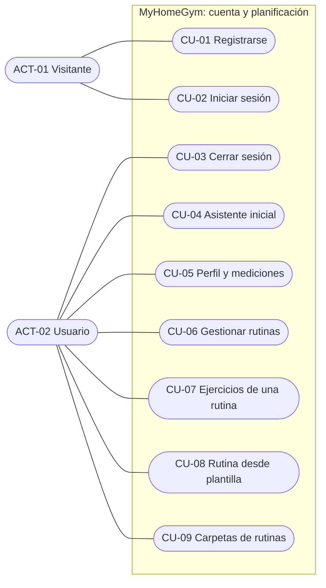
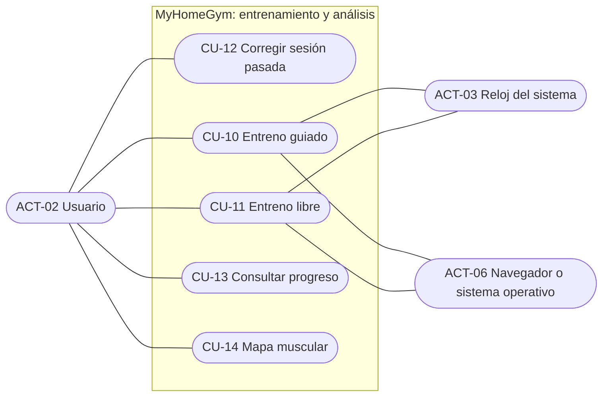
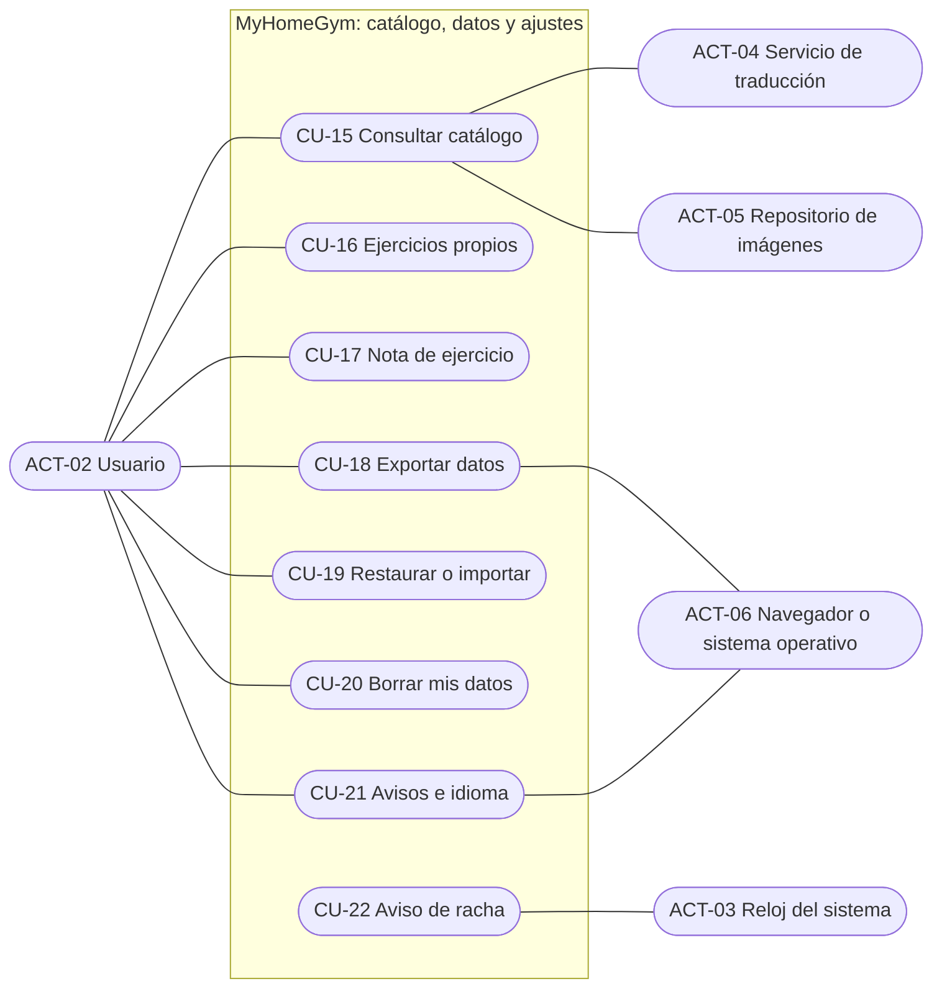

# 8. Actores y casos de uso

[← Índice de la ERS](../REQUISITOS_FUNCIONALES_Y_ACEPTACION.md)

## 8.1 Actores

| Id | Actor | Tipo | Descripción |
| --- | --- | --- | --- |
| ACT-01 | Visitante | Principal, humano | Persona sin sesión iniciada. Solo puede registrarse, iniciar sesión y consultar el catálogo público de la API. |
| ACT-02 | Usuario | Principal, humano | Persona con sesión iniciada. Es la propietaria de todos sus datos y solo ve los suyos. |
| ACT-03 | Reloj del sistema | Secundario, temporal | Dispara los avisos programados: fin del descanso y aviso de racha. |
| ACT-04 | Servicio de traducción | Secundario, sistema externo | MyMemory o LibreTranslate. Traduce las instrucciones del catálogo. No recibe datos del usuario. |
| ACT-05 | Repositorio de imágenes | Secundario, sistema externo | free-exercise-db en GitHub. Sirve las fotos del catálogo. |
| ACT-06 | Navegador o sistema operativo | Secundario, plataforma | Concede o deniega el permiso de avisos, guarda el entreno en curso y descarga los ficheros exportados. |

## 8.2 Diagramas de casos de uso

Los 22 casos de uso se dividen en tres diagramas para que se lean bien en pantalla y en papel. Las personas (visitante y usuario) están a la izquierda; el reloj, los servicios externos y el navegador, a la derecha. Los mismos diagramas, como imagen, están en [Diagramas](../DIAGRAMAS.md).

### 8.2.1 Cuenta y planificación

### 8.2.2 Entrenamiento y análisis

### 8.2.3 Catálogo, datos y ajustes

## 8.3 Catálogo de casos de uso

| Id | Caso de uso | Actor principal | Descripción breve | Objetivos | Prioridad | Frecuencia esperada |
| --- | --- | --- | --- | --- | --- | --- |
| CU-01 | Registrarse | Visitante | Crea una cuenta con usuario y contraseña y entra en la app. | OBJ-01, OBJ-07 | Must | Una vez por usuario |
| CU-02 | Iniciar sesión | Visitante | Entra con su usuario y contraseña. | OBJ-01, OBJ-07 | Must | Cada 30 días o menos |
| CU-03 | Cerrar sesión | Usuario | Sale de la cuenta en este dispositivo. | OBJ-07 | Must | Ocasional |
| CU-04 | Completar el asistente inicial | Usuario | Introduce nombre, peso, altura y medidas, y ve su IMC. | OBJ-01 | Must | Una vez |
| CU-05 | Gestionar el perfil y las mediciones | Usuario | Edita sus datos y añade o borra mediciones con fecha. | OBJ-01, OBJ-05 | Must | Semanal |
| CU-06 | Gestionar rutinas | Usuario | Crea, edita, pausa, reactiva o borra una rutina. | OBJ-02 | Must | Semanal o mensual |
| CU-07 | Configurar los ejercicios de una rutina | Usuario | Añade, quita, reordena y ajusta series, repeticiones y descanso. | OBJ-02 | Must | Semanal o mensual |
| CU-08 | Crear una rutina desde una plantilla | Usuario | Crea una rutina completa con un toque. | OBJ-02 | Should | Ocasional |
| CU-09 | Gestionar carpetas de rutinas | Usuario | Crea, renombra y borra carpetas. | OBJ-02 | Could | Ocasional |
| CU-10 | Realizar un entreno guiado | Usuario | Sigue una rutina serie a serie, con descansos y sugerencia de peso, y lo guarda. | OBJ-03, OBJ-04 | Must | 3 a 6 veces por semana |
| CU-11 | Realizar un entreno libre | Usuario | Añade ejercicios sobre la marcha y registra sus series. | OBJ-03 | Must | Ocasional |
| CU-12 | Consultar y corregir una sesión pasada | Usuario | Abre una sesión, corrige kilos o repeticiones, o la copia como texto o CSV. | OBJ-03, OBJ-05 | Should | Semanal |
| CU-13 | Consultar el progreso | Usuario | Ve el resumen semanal, la fuerza (1RM), los récords y la evolución corporal. | OBJ-04, OBJ-05 | Must | Semanal |
| CU-14 | Consultar el mapa muscular | Usuario | Ve qué músculos ha trabajado en un periodo y cuánto. | OBJ-05 | Should | Semanal |
| CU-15 | Consultar el catálogo y la ficha de un ejercicio | Usuario | Busca y filtra ejercicios y ve fotos, músculos, instrucciones e historial. | OBJ-06 | Must | Varias veces por semana |
| CU-16 | Gestionar ejercicios propios | Usuario | Crea, edita y borra ejercicios que no están en el catálogo. | OBJ-06 | Must | Ocasional |
| CU-17 | Gestionar la nota de un ejercicio | Usuario | Escribe y guarda una nota personal por ejercicio. | OBJ-06 | Could | Ocasional |
| CU-18 | Exportar los datos | Usuario | Descarga una copia JSON, los entrenos en CSV o un resumen en PDF. | OBJ-07 | Must | Mensual |
| CU-19 | Restaurar una copia o importar entrenos | Usuario | Añade a su cuenta los datos de una copia JSON o de un CSV. | OBJ-07 | Must | Rara |
| CU-20 | Borrar todos mis datos | Usuario | Elimina todos sus datos conservando la cuenta. | OBJ-07 | Must | Rara |
| CU-21 | Configurar avisos e idioma | Usuario | Activa avisos, elige la hora del aviso de racha y cambia el idioma. | OBJ-03, OBJ-08 | Should | Ocasional |
| CU-22 | Recibir el aviso de racha | Reloj del sistema | Avisa al usuario de que su racha está en peligro. | OBJ-05 | Could | Como mucho una vez al día |

Los casos de uso principales están detallados en [09-casos-de-uso-detallados.md](09-casos-de-uso-detallados.md). El resto son operaciones de alta, baja y modificación cuyo detalle está en sus requisitos funcionales y pruebas de aceptación.
