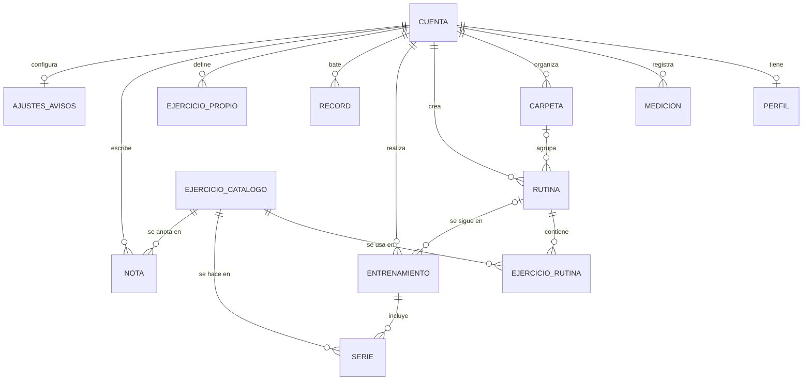

# 10. Requisitos de información

[← Índice de la ERS](../REQUISITOS_FUNCIONALES_Y_ACEPTACION.md)

Qué información debe almacenar el sistema. Todos los datos de usuario (RI-02 a RI-13) son **privados de su propietario**: el propietario se asigna en el servidor a partir del token y nunca lo envía el cliente (RN-1.08). Todos tienen un identificador único generado en el cliente (UUID) y una fecha de última modificación.

Notación: **obligatorio** = el servidor rechaza el registro si falta; ≥ 0 = cero o positivo; *máx. n* = longitud máxima en caracteres.

## RI-01 Cuenta de usuario

| Atributo | Valor |
| --- | --- |
| Objetivos / requisitos | OBJ-01, OBJ-07 / FR-1.01 a FR-1.04, RN-1.01 a RN-1.07 |
| Datos | Nombre de usuario (obligatorio, 3 a 40 caracteres, `[a-zA-Z0-9._-]`, único); hash BCrypt de la contraseña (nunca la contraseña); fecha de alta. |
| Datos asociados | Tokens de refresco: solo el SHA-256 del token, fecha de caducidad (30 días) y si está revocado. |
| Vida | Indefinida. "Borrar todos mis datos" no borra la cuenta. |
| Ocurrencias simultáneas | Ilimitadas (uso previsto: de 1 a 5 cuentas por servidor). |

## RI-02 Perfil

| Atributo | Valor |
| --- | --- |
| Objetivos / requisitos | OBJ-01 / FR-1.05 a FR-1.07, RN-1.09 |
| Datos | Nombre (*máx. 120*); peso corporal en kg (obligatorio, ≥ 0; el formulario exige 1 a 500); altura en cm (obligatoria, ≥ 0; el formulario exige 80 a 250); cintura, pecho y pierna en cm (opcionales); IMC calculado. |
| Vida | Hasta que el usuario borre sus datos. |
| Ocurrencias | Uno por usuario. |

## RI-03 Medición corporal

| Atributo | Valor |
| --- | --- |
| Objetivos / requisitos | OBJ-01, OBJ-05 / FR-1.08, FR-1.09, FR-4.09, RN-1.10 |
| Datos | Fecha de registro (obligatoria); peso corporal en kg (obligatorio, ≥ 0); cintura, pecho, hombros, bíceps, pierna y gemelo en cm (opcionales); IMC. |
| Vida | Hasta que el usuario la borre. |
| Ocurrencias | Ilimitadas (previsto: una por semana, unas 50 al año). |

## RI-04 Rutina y carpeta de rutinas

| Atributo | Valor |
| --- | --- |
| Objetivos / requisitos | OBJ-02 / FR-2.01 a FR-2.03, FR-2.08, RN-2.02 a RN-2.06, RN-2.08 |
| Datos de la rutina | Nombre (obligatorio, *máx. 120*); descripción (*máx. 1.000*); días de la semana (lista normalizada: `lunes` … `domingo`); activa o en pausa; color (*máx. 32*); carpeta (opcional). |
| Datos de la carpeta | Nombre (obligatorio, *máx. 120*); descripción; color; orden. |
| Vida | Hasta que el usuario las borre. Borrar una carpeta deja sus rutinas sin carpeta. |
| Ocurrencias | Previsto: menos de 20 rutinas y 10 carpetas por usuario. |

## RI-05 Ejercicio de una rutina

| Atributo | Valor |
| --- | --- |
| Objetivos / requisitos | OBJ-02 / FR-2.04 a FR-2.07, RN-2.01, RN-2.05, RN-2.07 |
| Datos | Rutina (obligatoria); ejercicio (obligatorio: id del catálogo o de un ejercicio propio); orden; series (de 1 a 20; el formulario permite 1 a 12); repeticiones objetivo (*máx. 40*: número o rango); descanso en segundos (de 0 a 3.600; el formulario ofrece 60, 90, 120, 150, 180 y 240); peso sugerido, RPE y notas (opcionales). |
| Vida | Se borra con su rutina. |

## RI-06 Entrenamiento

| Atributo | Valor |
| --- | --- |
| Objetivos / requisitos | OBJ-03, OBJ-05 / FR-3.17, FR-3.19, RN-3.04 a RN-3.07 |
| Datos | Fecha y hora (obligatoria, ISO 8601); rutina (opcional: vacía en el entreno libre); duración en minutos (≥ 0; el formulario exige 1 a 300); volumen total en kg (≥ 0); notas (*máx. 2.000*); completado. |
| Vida | Indefinida. **No se borra al borrar su rutina** (RN-2.05). |
| Ocurrencias | Previsto: de 150 a 300 al año por usuario. |

## RI-07 Serie realizada

| Atributo | Valor |
| --- | --- |
| Objetivos / requisitos | OBJ-03, OBJ-04 / FR-3.03 a FR-3.06, RN-3.01 a RN-3.07 |
| Datos | Entrenamiento (obligatorio); ejercicio (obligatorio); número de serie; repeticiones (≥ 0; solo se guardan si son > 0); peso en kg (≥ 0: 0 = peso corporal); RPE (opcional: de 1 a 10; la app ofrece de 6 a 10 en pasos de 0,5); tipo (solo `normal`, `warmup`, `dropset` o `failure`); fecha. |
| Vida | Se borra con su entrenamiento. |
| Ocurrencias | Previsto: unas 20 por entreno, unas 6.000 al año por usuario. |

## RI-08 Récord personal

| Atributo | Valor |
| --- | --- |
| Objetivos / requisitos | OBJ-04 / FR-4.05, RN-4.05 a RN-4.09 |
| Datos | Ejercicio (obligatorio; `GLOBAL` para el récord de sesión); tipo (obligatorio, solo uno de: `peso_maximo`, `reps_mismo_peso`, `volumen_serie`, `volumen_total`); valor (obligatorio); fecha (obligatoria); detalle (*máx. 300*): la serie que lo consiguió, o el peso en los récords de repeticiones (`a 60kg`); vacío en el récord de sesión. |
| Vida | Indefinida. Se conserva aunque se borre el entreno que lo originó. Se recalcula si se corrige su sesión o una anterior (RN-4.15). |

## RI-09 Ejercicio del catálogo

| Atributo | Valor |
| --- | --- |
| Objetivos / requisitos | OBJ-06 / FR-5.01 a FR-5.07, RN-5.01 a RN-5.09 |
| Datos | Id; nombre original (inglés); nombre en español; músculos principales y secundarios; material; nivel; mecánica; tipo de fuerza; categoría; dos fotos; instrucciones (pasos). |
| Origen | free-exercise-db (dominio público), en `backend/src/main/resources/catalog/exercises/`: un fichero por músculo principal y un ejercicio por línea. |
| Vida | Solo lectura para los usuarios. Cambia con las versiones de la app. |
| Ocurrencias | 876. Común a todos los usuarios. |

## RI-10 Traducción de instrucciones (caché)

| Atributo | Valor |
| --- | --- |
| Objetivos / requisitos | OBJ-06, OBJ-08 / FR-5.07, RN-5.05, RN-5.06 |
| Datos | Hash del texto original; idioma; texto traducido; proveedor; fecha. |
| Vida | Indefinida. Solo se guardan las traducciones correctas, nunca los fallos. |

## RI-11 Ejercicio propio

| Atributo | Valor |
| --- | --- |
| Objetivos / requisitos | OBJ-06 / FR-5.08 |
| Datos | Nombre (obligatorio, *máx. 160*); grupo muscular principal (obligatorio, *máx. 40*); grupos secundarios; tipo; nivel; material (*máx. 80*); URL de imagen (*máx. 1.000*); instrucciones (*máx. 4.000*, un paso por línea). |
| Vida | Hasta que el usuario lo borre. Al borrarlo se quita de las rutinas y se borra su nota (RN-5.12); las series ya registradas con él se conservan. |

## RI-12 Nota de ejercicio

| Atributo | Valor |
| --- | --- |
| Objetivos / requisitos | OBJ-06 / FR-5.09, RN-5.10, RN-5.11 |
| Datos | Ejercicio (obligatorio, *máx. 120*); texto (obligatorio, puede estar vacío, *máx. 4.000*). |
| Ocurrencias | Como mucho una por usuario y ejercicio. |

## RI-13 Ajustes de avisos

| Atributo | Valor |
| --- | --- |
| Objetivos / requisitos | OBJ-03, OBJ-05 / FR-6.07, FR-6.08, RN-6.06, RN-6.07 |
| Datos | Aviso de racha activado (por defecto, sí); hora del aviso (0 a 23, por defecto 19); aviso de fin de descanso activado (por defecto, sí). |
| Ocurrencias | Uno por usuario. |

## RI-14 Entreno en curso (almacenamiento local)

| Atributo | Valor |
| --- | --- |
| Objetivos / requisitos | OBJ-03 / FR-3.16, RN-3.08 |
| Datos | Rutina elegida; valores de cada serie (kilos, repeticiones, RPE, tipo, hecha); borrador del entreno libre; segundos del cronómetro; ejercicio activo. |
| Dónde | En el navegador (`localStorage`), **no en el servidor**. |
| Vida | Desde que se empieza un entreno hasta que se termina o se descarta. Sobrevive a "Borrar caché y recargar" (RN-6.14). |

## Relaciones entre los datos

`EJERCICIO_RUTINA`, `SERIE`, `RECORD` y `NOTA` pueden referirse tanto a un ejercicio del catálogo como a un ejercicio propio. El servidor no impone claves ajenas entre estas tablas: la coherencia la mantiene la app (por ejemplo, borrando las series al borrar su entreno).
